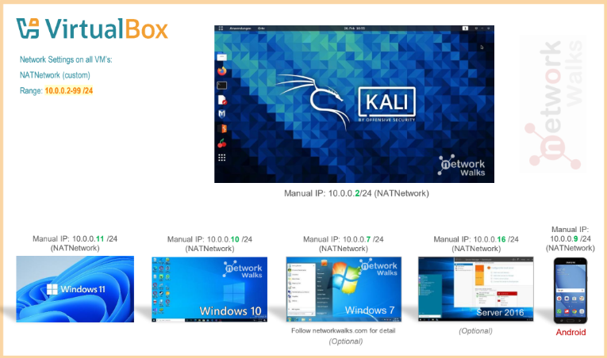
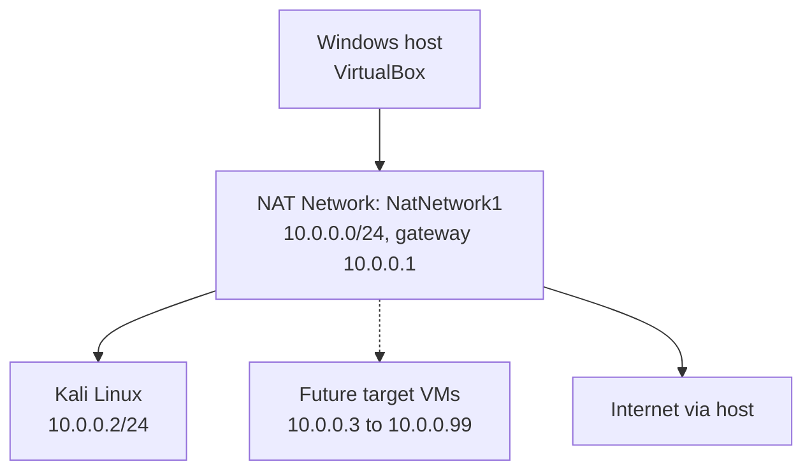
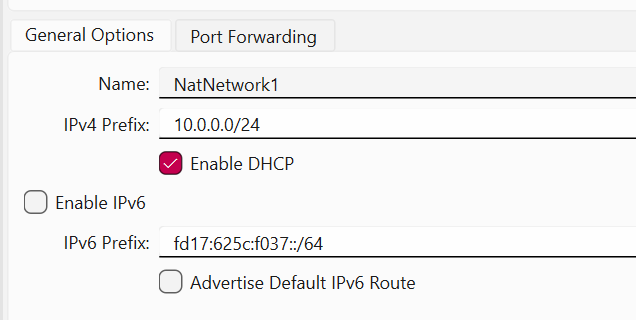
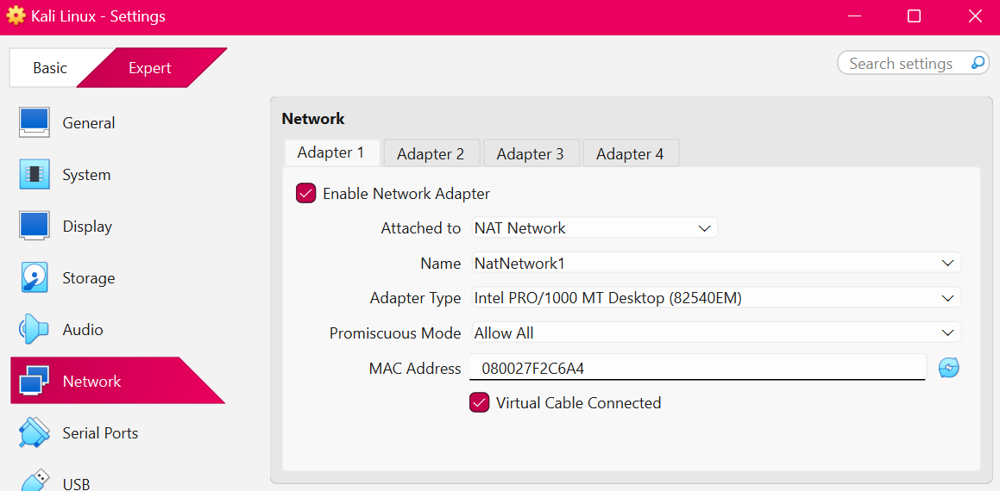
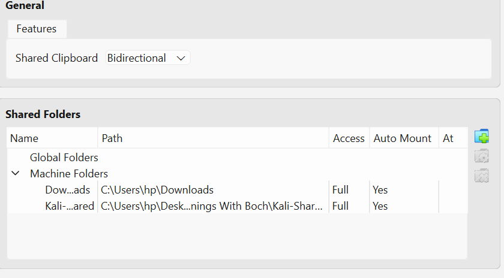
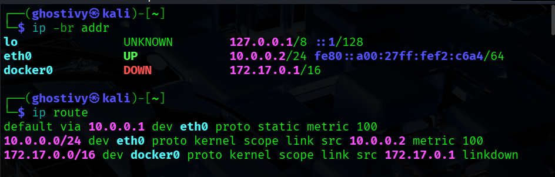
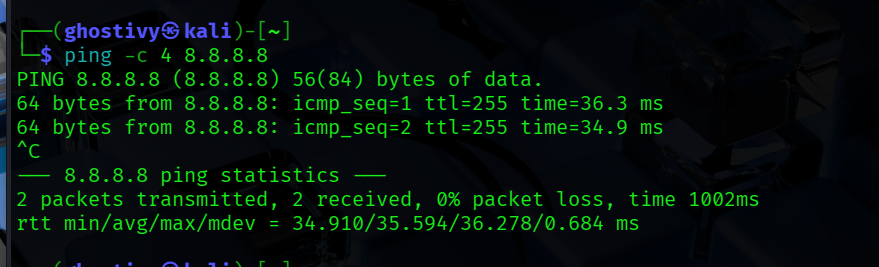
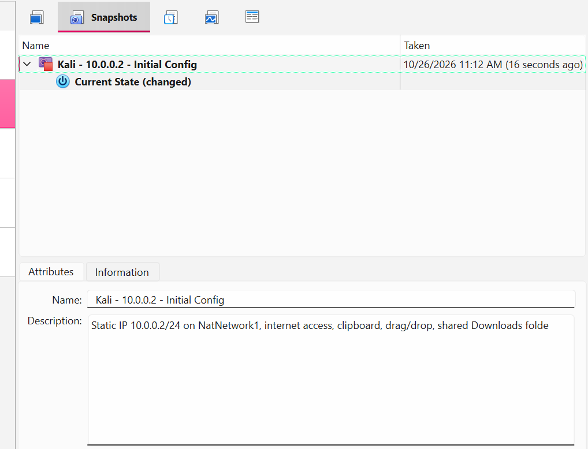

# Cybersecurity Lab Environment Setup


**Week 1 | Project Module 1 (WK1-PM1) | Networkwalks Cybersecurity and Ethical Hacking Program | Batch B084C**

An isolated virtual lab built with VirtualBox and Kali Linux for cybersecurity testing and penetration testing practice. Kali is the attacking machine on a private NAT Network, ready to host target VMs in later projects.

---

## Table of Contents

1. [Project Overview](#project-overview)
2. [Objectives](#objectives)
3. [Requirements Traceability](#requirements-traceability)
4. [Lab Configuration](#lab-configuration)
5. [Lab Architecture](#lab-architecture)
6. [Setup Procedure](#setup-procedure)
7. [Reproducible Setup (Command Line)](#reproducible-setup-command-line)
8. [Lab Verification](#lab-verification)
9. [Problems Encountered and Solutions](#problems-encountered-and-solutions)
10. [Security Considerations](#security-considerations)
11. [What I Learned](#what-i-learned)
12. [Repository Structure](#repository-structure)
13. [Security and Ethical Use](#security-and-ethical-use)
14. [Tools and Resources](#tools-and-resources)
15. [Author](#author)

---

## Project Overview

This project builds a virtual cybersecurity laboratory on a Windows host. A VirtualBox NAT Network provides a private 10.0.0.0/24 subnet. The VMs on it can reach each other and share the host's Internet connection, but they are not reachable from outside, which makes it a safe place to practise scanning, reconnaissance and other authorised testing.

## Objectives

- Install VirtualBox and run Kali Linux as the attacking machine.
- Create a NAT Network on 10.0.0.0/24.
- Give Kali the static address 10.0.0.2/24 with full Internet access.
- Enable the shared clipboard, drag and drop, and a shared folder from the host.
- Take a snapshot of the working VM as a recovery point.
- Document the setup, the verification and the problems solved.

## Requirements Traceability

Each requirement from the task, and the evidence for it:

| # | Task requirement | Status | Evidence |
|---|---|---|---|
| 1 | Use VirtualBox as the base (latest recommended version) | Done | Screenshot 1 |
| 2 | Set up Kali Linux as the attacking machine | Done | Screenshots 2 and 4 |
| 3 | Network in subnet 10.0.0.0/24 | Done | Screenshot 1 |
| 4 | Use a NAT Network with 10.0.0.0/24 | Done (NatNetwork1) | Screenshots 1 and 2 |
| 5 | Clipboard and drag/drop enabled | Done (Bidirectional) | Screenshot 3 |
| 6 | Shared folder from the host Downloads folder | Done | Screenshot 3 |
| 7 | Kali IP address is 10.0.0.2/24 | Done | Screenshot 4 |
| 8 | Kali has full Internet access | Done | Screenshot 5 |
| 9 | Snapshot of the VM | Done | Screenshot 6 |

## Lab Configuration

| Component | Configuration |
|---|---|
| Host OS | Windows |
| Hypervisor | VirtualBox (latest recommended version at time of setup) |
| Attacking machine | Kali Linux |
| Virtual network | NAT Network "NatNetwork1" |
| Network address | 10.0.0.0/24, DHCP enabled, IPv6 disabled |
| Kali address | 10.0.0.2/24 (static) |
| Default gateway | 10.0.0.1 |
| DNS server | 8.8.8.8 |
| Adapter 1 | NAT Network, Intel PRO/1000 MT Desktop, promiscuous mode Allow All |
| Backup adapter (optional) | Plain NAT, kept at a higher route metric (300) |
| Clipboard and drag/drop | Bidirectional |
| Shared folder | Host Downloads folder, Auto-mount and Make Permanent |

### IP plan

| Address | Purpose |
|---|---|
| 10.0.0.1 | Gateway (VirtualBox NAT Network) |
| 10.0.0.2 | Kali Linux (attacker) |
| 10.0.0.3 to 10.0.0.99 | Reserved for future lab VMs |

## Lab Architecture



*Reference architecture from the Networkwalks course material. Kali Linux (10.0.0.2) is the Project Module 1 deliverable. The other VMs shown are optional or built in later projects.*

The diagram below shows what was built for this project:



## Setup Procedure

### Step 1. Create the NAT Network

NatNetwork1 was created in VirtualBox (File > Tools > Network > NAT Networks) with the prefix 10.0.0.0/24 and DHCP enabled. A NAT Network, unlike plain NAT, lets every VM attached to it talk to the others while still sharing the host's Internet connection.



*Proof: the NAT Network exists on 10.0.0.0/24 with DHCP enabled.*

### Step 2. Attach Kali Linux to the NAT Network

Kali was imported from the official download. Adapter 1 was set to NAT Network, name NatNetwork1, adapter type Intel PRO/1000 MT Desktop, promiscuous mode Allow All, cable connected.



*Proof: Kali is attached to the lab network, not plain NAT.*

### Step 3. Enable clipboard, drag and drop, and the shared folder

Shared Clipboard and Drag'n'Drop were set to Bidirectional. The host Downloads folder was added as a shared folder with Auto-mount and Make Permanent. Inside Kali the user was added to the vboxsf group so the mounted folder is accessible.



*Proof: clipboard, drag/drop and the shared folder are configured.*

### Step 4. Configure the static IP address

```bash
sudo nmcli connection modify "Wired connection 1" \
  ipv4.method manual ipv4.addresses 10.0.0.2/24 \
  ipv4.gateway 10.0.0.1 ipv4.dns 8.8.8.8 \
  ipv4.dad-timeout 0 ipv4.route-metric 100
sudo nmcli connection down "Wired connection 1"
sudo nmcli connection up "Wired connection 1"
```

The connection name was confirmed with `nmcli connection show` first. The settings survived a reboot.



*Proof: Kali holds 10.0.0.2/24 with a default route through 10.0.0.1.*

### Step 5. Verify connectivity

The gateway, an external IP and a domain name were tested from Kali.



*Proof: routing, Internet access and DNS all work.*

### Step 6. Take a snapshot

Once everything was verified, a snapshot was taken as the clean baseline.



*Proof: a recovery point exists for the working configuration.*

## Reproducible Setup (Command Line)

The same configuration can be built from the command line. On the Windows host, with the VM name replaced as needed:

```powershell
$vbm = "C:\Program Files\Oracle\VirtualBox\VBoxManage.exe"
& $vbm natnetwork add --netname NatNetwork1 --network "10.0.0.0/24" --enable --dhcp on
& $vbm modifyvm "Kali Linux" --nic1 natnetwork --nat-network1 NatNetwork1 --nicpromisc1 allow-all
& $vbm modifyvm "Kali Linux" --clipboard-mode bidirectional --draganddrop bidirectional
& $vbm sharedfolder add "Kali Linux" --name Downloads --hostpath "C:\Users\<user>\Downloads" --automount
& $vbm snapshot "Kali Linux" take "Kali - 10.0.0.2 - Initial Config"
```

Inspect what VirtualBox actually has configured:

```powershell
& $vbm natnetwork list
& $vbm showvminfo "Kali Linux" --machinereadable | findstr /i "nic natnet"
```

## Lab Verification

| Test | Command | Expected | Result |
|---|---|---|---|
| IP address | `ip -br addr` | 10.0.0.2/24 | Pass |
| Default route | `ip route` | default via 10.0.0.1 | Pass |
| Gateway | `ping -c 3 10.0.0.1` | Replies | Pass |
| Internet by IP | `ping -c 3 8.8.8.8` | Replies | Pass |
| DNS | `ping -c 3 google.com` | Resolves, replies | Pass |
| HTTPS | `curl -I https://www.kali.org` | HTTP/2 200 | Pass |
| Persistence | Reboot, then `ip -br addr` | Static IP retained | Pass |

The Internet tests also pass with the backup adapter disconnected, which shows that the NAT Network alone provides full Internet access.

## Problems Encountered and Solutions

| Symptom | Cause | Fix |
|---|---|---|
| Kali had 10.0.2.x and 10.0.3.x addresses, and two default routes | The NAT Network prefix had been set wrongly, and a second adapter on plain NAT was still enabled | Corrected the NAT Network to 10.0.0.0/24, re-attached Adapter 1, and gave the second adapter a higher route metric (300) so the lab adapter (metric 100) is preferred |
| Internet access can fail after a static IP on VirtualBox 7 with newer Kali | Duplicate-address detection delays the connection | `sudo nmcli connection modify "Wired connection 1" ipv4.dad-timeout 0`, then restart the connection |
| VirtualBox showed a different network name than expected | The NAT Network had been renamed to NatNetwork1 | Verified with `VBoxManage natnetwork list` and used the exact name in the adapter settings |
| DNS lookup fails while pings to 8.8.8.8 work | DNS server unreachable or not set | Set the DNS to 10.0.0.1 as the course guide suggests |

### Diagnostic approach

1. `ip -br addr` to see what address each interface holds.
2. `ip route` to confirm the default route.
3. `ping` the gateway, then an external IP, then a domain, to find which layer fails.
4. `VBoxManage` on the host to compare what VirtualBox has configured with what the guest sees.

## Security Considerations

- **Isolation:** a NAT Network keeps the lab VMs off the host's LAN. Only outbound traffic is translated, and nothing outside can reach the VMs unless port forwarding is added.
- **Promiscuous mode "Allow All":** needed so Kali can see traffic for packet analysis on the lab network. Use it only on this isolated network.
- **Shared folder:** it exposes a host folder to the guest. Share only what is needed, and consider read-only when testing untrusted targets.
- **Snapshots:** take one before risky experiments, and restore it when the VM is in doubt.
- **Authorisation:** only test systems you own or are explicitly permitted to test.

## What I Learned

- NAT and NAT Network differ: the second suits multi-VM labs because the VMs share one private subnet.
- `ip route` matters as much as `ip addr`: a VM can hold the right address and still have no usable default route.
- Comparing VirtualBox's configured state (`VBoxManage`) with the guest's view quickly pinpoints misconfigurations.
- Route metrics let one machine keep two adapters without the wrong one carrying the traffic.
- A snapshot taken after verification is a dependable restore point, and documenting fixes makes a lab repeatable.

## Repository Structure

```text
.
+-- README.md
+-- 1-screenshot-natnetwork.png
+-- 2-screenshot-kali-adapter.png
+-- 3-screenshot-clipboard-shared-folder.png
+-- 4-screenshot-kali-ip.png
+-- 5-screenshot-kali-connectivity.png
+-- 6-screenshot-snapshot.png
+-- 7-lab-architecture.png
```

## Security and Ethical Use

This lab is for education and authorised security testing only. Use these tools only on systems you own or have explicit written permission to test.

## Tools and Resources

- 7-Zip: https://7-zip.org/download.html
- VirtualBox: https://virtualbox.org/wiki/Downloads
- Kali Linux: https://kali.org/get-kali
- Mermaid diagrams on GitHub: https://docs.github.com/en/get-started/writing-on-github/working-with-advanced-formatting/creating-diagrams

## Author

**Natasha Iyowe** | Networkwalks Cybersecurity Program, Batch B084C
